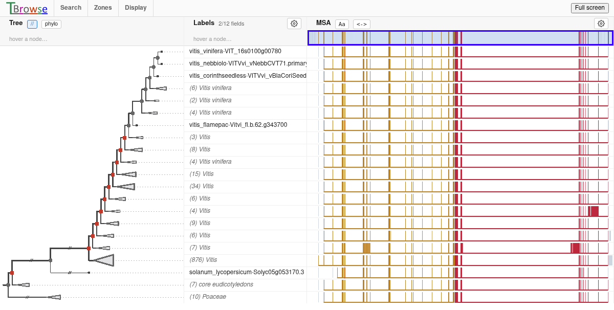

_Last updated: November 17, 2026_

**Ask the Grapevine PanGenome questions with an AI assistant**

You can ask questions about the Gramene Grapevine PanGenome in plain language and let an AI assistant look up the answers: genes and their function, orthologs and gene trees, presence, absence and copy number across grape cultivars and wild _Vitis_ species, and expression. This server holds Grapevine PanGenome release 5, with 30 _Vitis_ genomes (wine and table grape cultivars, rootstock and wild species) plus Arabidopsis, tomato, rice, sorghum and other reference species.

The connection uses the Model Context Protocol (MCP), an open standard that lets an AI assistant call tools on a remote server. The Grapevine PanGenome MCP server is free and read-only, and it needs no account or sign-in with us. This guide uses Claude because it supports MCP servers on its free plan; other assistants are covered [further down](#other-ai-tools).

- [1. Get an assistant](#1-get-an-assistant)
- [2. Add the Grapevine PanGenome connector](#2-add-the-grapevine-pangenome-connector)
- [3. Turn it on in a chat](#3-turn-it-on-in-a-chat)
- [4. Example questions](#4-example-questions)
- [5. Browse a gene tree](#5-browse-a-gene-tree)
- [Tips](#tips)
- [Other AI tools](#other-ai-tools)
- [What the assistant can do](#what-the-assistant-can-do)
- [Privacy](#privacy)

---

## 1. Get an assistant

1. Create an account at [claude.ai](https://claude.ai). The free plan is enough to try this.
2. Use Claude in your browser, or install the desktop app for macOS or Windows.

Free plans limit how many custom connectors you can add and how many messages you can send in a few hours. A question that needs many lookups uses that allowance faster than an ordinary chat.

## 2. Add the Grapevine PanGenome connector

The server address is:

```
https://data.gramene.org/mcp/grapevine_v5
```

1. In Claude, open **Settings** and choose **Connectors**.
2. Choose **Add custom connector**.
3. Enter a name, for example `Gramene Grapevine`, and paste the address above.
4. Leave the sign-in (OAuth) fields empty and choose **Add**.

On a Team or Enterprise plan, an organization owner may need to add the connector once before members can switch it on.

## 3. Turn it on in a chat

Start a new chat, open the tools menu below the message box, and switch **Gramene Grapevine** on. The first time Claude uses one of the tools it asks for permission; you can allow it once or for the whole chat.

Gramene runs a separate server for each of its sites, and they all offer the same tools. Keep only the one you need switched on in a chat, so the assistant does not mix data from two releases.

## 4. Example questions

Copy a question, paste it into the chat, and change the gene, region or trait to your own. The line under each question says what the answer draws on.

### Genes and IDs

```
What is the grapevine gene VIT_16s0100g00780? Give its location in PN40024 v3 and what is known about its function.
```
Gene record: location, description, protein domains and GO terms.

```
Find the genes annotated as stilbene synthases in PN40024 v3 and list them with their positions.
```
Search by description within one annotation; most are clustered on chromosome 16.

```
Which PN40024 v3 gene model corresponds to the v4 gene Vitvi16g01857?
```
Maps a gene model between the two reference annotations.

### Regions

```
List the PN40024 v3 genes on chromosome 16 between 16.25 and 16.55 Mb, with a short description of each.
```
Genes in an interval of the reference genome; the stilbene synthase cluster.

```
What are the ten genes on either side of VIT_16s0100g00780?
```
Genomic neighbourhood of one gene.

### Orthologs and gene families

```
What are the Arabidopsis and tomato orthologs of VIT_16s0100g00780?
```
Orthologs from the Compara gene trees, by species.

```
How many paralogs does VIT_16s0100g00780 have in PN40024 v3?
```
Within-genome duplicates; stilbene synthases are a large tandem family.

```
How many PN40024 v4 genes have a terpene synthase domain? Count them per chromosome.
```
Search by protein domain, summarized by location.

### Across cultivars and wild species

```
How many stilbene synthase genes does each grapevine genome have? Rank the cultivars and wild species by copy number.
```
Copy counts per genome for one gene family; counts differ between genomes.

```
Is VIT_16s0100g00780 present in Chardonnay, Cabernet Sauvignon and Merlot?
```
Presence/absence in named cultivars.

```
How many protein-coding genes in PN40024 v4 have no ortholog in Vitis riparia?
```
A count across two genomes; ask for a sample of the genes if you want examples.

### Expression

```
In which tissues and conditions is VIT_16s0100g00780 expressed? Name the experiments.
```
Expression from curated RNA-seq experiments.

```
Which PN40024 v3 stilbene synthase genes are expressed in the fruit, and which only in other organs?
```
Combines a gene family with per-organ expression calls.

### Pathways and literature

```
Which PN40024 v3 genes are annotated with trihydroxystilbene synthase activity?
```
Gene Ontology annotation within one species.

```
What has been published on the Arabidopsis orthologs of VIT_16s0100g00780?
```
Curated literature for the model-species orthologs of a grapevine gene.

### Sequences

```
Give me the protein sequence of VIT_16s0100g00780 in FASTA format.
```
Sequence of the canonical transcript; genomic, cDNA and CDS are also available.

**Not on this site:** grapevine QTL, germplasm with loss-of-function alleles, and variant (rsID) lookups. Few grapevine genes have curated publications or gene symbols, so literature questions work best through Arabidopsis or tomato orthologs, as in the example above.

## 5. Browse a gene tree

Ask to *see* a gene tree and the assistant opens an interactive viewer in the conversation instead of describing the tree in text:

```
Show me the gene tree for the grapevine stilbene synthase VIT_16s0100g00780.
```



The viewer shows the phylogeny with speciation and duplication nodes, gene labels and the protein alignment with its domains. You can collapse or prune clades, search for a gene, add the gene-neighbourhood and gene-structure panels from the **Zones** menu, and switch to full screen. Clicking a gene offers **Ask about this gene**, which sends that gene back to the chat as your next question.

The viewer appears in assistants that support MCP Apps, which include Claude on the web and the desktop app. Elsewhere you get a short text summary of the tree.

## Tips

- **Give stable IDs when you have them.** `VIT_16s0100g00780` is unambiguous; a gene symbol may match several genes, or genes in other species.
- **Name the genome.** Two versions of the PN40024 reference are here: PN40024 v3 (the 12X gene models, `VIT_…` IDs) and PN40024 v4 (`Vitvi…` IDs). Say which you mean, or name the cultivar (Chardonnay, Cabernet Sauvignon, Merlot) when you mean another genome.
- **Be specific.** Name the organ ("inflorescence", "root") and say how to rank or filter. "Rank by root expression and ortholog function" gives a more repeatable answer than "find the best candidates".
- **Ask for counts before lists.** "How many genes…" is quick; a list of several thousand genes is long and will be cut short.
- **Ask for links.** The assistant can give the Grapevine PanGenome site links for the genes it reports, so you can check them in the browser.
- **Say what you want back.** A table, a ranked shortlist, FASTA, or a file to download.
- **Check before you act.** AI answers can be wrong. Confirm gene IDs, positions and germplasm names on [the Grapevine PanGenome site](https://vitis.gramene.org) before ordering seed or designing an experiment.

## Other AI tools

Any assistant or client that supports remote MCP servers over streamable HTTP can use the same address. In Claude Code:

```
claude mcp add --transport http gramene-grapevine https://data.gramene.org/mcp/grapevine_v5
```

Setup instructions for VS Code, Cursor and other clients are in the [gramene-mcp README](https://github.com/warelab/gramene-mcp#connecting-to-mcp-clients).

## What the assistant can do

You do not need to name these tools; the assistant picks them. The table is here so you know what is possible.

| Tool | What it does |
|---|---|
| `solr_suggest` | Turns a word or phrase (a gene name, trait, pathway, protein domain, species) into the matching search terms |
| `gene_search`, `solr_search`, `solr_search_bool` | Find genes by any combination of filters, and count or summarize them |
| `resolve_gene_ids` | Maps older or alternative gene IDs to current ones |
| `genes_in_region` | Lists the genes in a chromosome interval |
| `expand_gene_set` | Orthologs, paralogs, whole gene families and neighbouring genes |
| `gene_tree_view` | Opens the interactive gene tree viewer |
| `expression_for_genes` | Expression by tissue and condition from curated RNA-seq experiments |
| `pubmed_for_genes` | Publications linked to genes |
| `gene_sequence` | Genomic, cDNA, CDS or protein sequence |
| `mongo_find`, `mongo_lookup_by_ids` | Full records for genes, gene trees, genomes, ontology terms, pathways and QTL |

## Privacy

Your questions go to the AI provider you chose, under that provider's terms. Our server receives only the tool requests the assistant makes on your behalf, such as "genes in this region", and keeps a log of those requests, as any web server does. It never sees the rest of your conversation.

Questions or problems? Use the feedback link on [the Grapevine PanGenome site](https://vitis.gramene.org).
