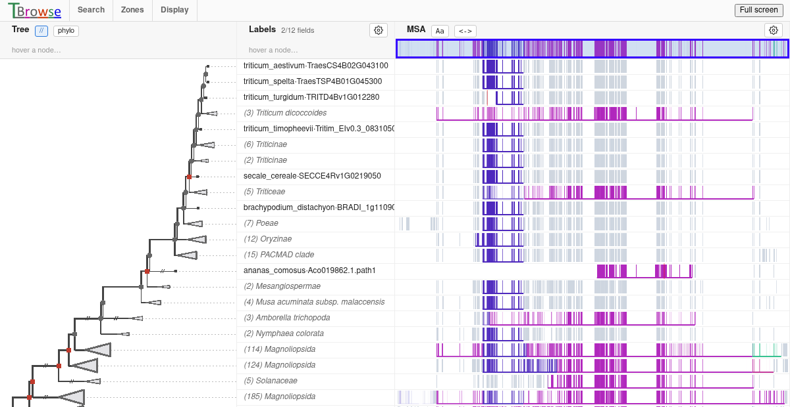

_Last updated: November 17, 2026_

**Ask Gramene questions with an AI assistant**

You can ask questions about Gramene's comparative plant genomics data in plain language and let an AI assistant look up the answers: genes and their function, orthologs and gene families across species, expression, pathways and rice QTL. This server holds Gramene release 70, with 267 plant and algal genomes, including pan-genome sets for barley (77 genomes), oats (33), rice (26) and wheat (24).

The connection uses the Model Context Protocol (MCP), an open standard that lets an AI assistant call tools on a remote server. The Gramene MCP server is free and read-only, and it needs no account or sign-in with us. This guide uses Claude because it supports MCP servers on its free plan; other assistants are covered [further down](#other-ai-tools).

- [1. Get an assistant](#1-get-an-assistant)
- [2. Add the Gramene connector](#2-add-the-gramene-connector)
- [3. Turn it on in a chat](#3-turn-it-on-in-a-chat)
- [4. Example questions](#4-example-questions)
- [5. Browse a gene tree](#5-browse-a-gene-tree)
- [Tips](#tips)
- [Other AI tools](#other-ai-tools)
- [What the assistant can do](#what-the-assistant-can-do)
- [Privacy](#privacy)

---

## 1. Get an assistant

1. Create an account at [claude.ai](https://claude.ai). The free plan is enough to try this.
2. Use Claude in your browser, or install the desktop app for macOS or Windows.

Free plans limit how many custom connectors you can add and how many messages you can send in a few hours. A question that needs many lookups uses that allowance faster than an ordinary chat.

## 2. Add the Gramene connector

The server address is:

```
https://data.gramene.org/mcp/v70
```

1. In Claude, open **Settings** and choose **Connectors**.
2. Choose **Add custom connector**.
3. Enter a name, for example `Gramene Plants`, and paste the address above.
4. Leave the sign-in (OAuth) fields empty and choose **Add**.

On a Team or Enterprise plan, an organization owner may need to add the connector once before members can switch it on.

## 3. Turn it on in a chat

Start a new chat, open the tools menu below the message box, and switch **Gramene Plants** on. The first time Claude uses one of the tools it asks for permission; you can allow it once or for the whole chat.

Gramene runs a separate server for each of its sites, and they all offer the same tools. Keep only the one you need switched on in a chat, so the assistant does not mix data from two releases.

## 4. Example questions

Copy a question, paste it into the chat, and change the gene, region or trait to your own. The line under each question says what the answer draws on.

### Genes and IDs

```
What is known about the Arabidopsis gene FLC (AT5G10140)? Give its location, protein domains and GO terms.
```
Gene record with InterPro domains and ontology annotation.

```
Find the wheat gene Rht-B1 and tell me which genome and chromosome it is on.
```
Name search across species; the answer should give TraesCS4B02G043100.

```
How many genes in the barley reference genome (Hordeum vulgare, Morex V3) are in the gibberellin signaling pathway?
```
A count by pathway within one genome.

### Regions

```
List the genes on chromosome 4B of the bread wheat reference (Triticum aestivum, Chinese Spring) between 30 and 32 Mb.
```
Genes in an interval of one genome; the interval contains Rht-B1.

```
What are the ten genes on either side of AT5G10140?
```
Genomic neighbourhood of one gene.

### Orthologs across species

```
What are the rice, maize and sorghum orthologs of the wheat gene TraesCS4B02G043100?
```
Orthologs from the Compara gene trees, by species.

```
Does AT5G10140 have paralogs in Arabidopsis? List them with their names.
```
Within-genome duplicates; FLC has a family of MADS-box relatives.

```
Which one-to-one orthologs of AT1G17420 exist in the Brassicaceae?
```
The strictest ortholog class, limited to one clade.

### Gene families

```
How many members of the FLC (AT5G10140) gene family do Arabidopsis, rice, maize and bread wheat each have?
```
Copy counts per species for one gene tree.

```
How many genes with a MADS-box domain (InterPro IPR002100) do Arabidopsis, rice, barley and bread wheat each have?
```
Family size by protein domain, compared between species.

### Cereal pan-genomes

```
Which barley pan-genome assemblies have no ortholog of the wheat gene TraesCS4B02G043100 (Rht-B1)?
```
Presence/absence across the barley pan-genome. No ortholog can mean the gene is absent or was not annotated.

```
Which wheat assemblies have a gene named Rht-B1, and where is it in each?
```
Name search across the wheat pan-genome.

### Expression

```
In which Arabidopsis organs is FLC (AT5G10140) most highly expressed? Give the TPM for each organ.
```
Expression level per organ, summarised from curated RNA-seq experiments.

```
Compare the tissue expression of AT1G17420 with that of its rice and maize orthologs.
```
Expression of a gene and its orthologs side by side.

### Pathways, traits and QTL

```
Which bread wheat genes are in the gibberellin signaling pathway?
```
Plant Reactome pathway membership in one species.

```
Show five rice QTL from the Gramene QTL database annotated with plant height (TO:0000207), with their positions.
```
QTL records by Trait Ontology term and source.

### Literature and sequences

```
Which PubMed IDs are linked to FLC (AT5G10140)?
```
Curated PubMed IDs. To have the papers summarised, the assistant also needs a literature tool.

```
Give me the protein sequence of AT5G10140 in FASTA format.
```
Protein sequence of each transcript; genomic, cDNA and CDS are also available.

**Not on this site:** germplasm with loss-of-function alleles, and variant (rsID) lookups. For those, use the [SorghumBase](https://www.sorghumbase.org), [rice](https://oryza.gramene.org) or [maize](https://maize-pangenome.gramene.org) servers. QTL on this site are rice QTL from the Gramene QTL database and sorghum QTL from the Sorghum QTL Atlas.

## 5. Browse a gene tree

Ask to *see* a gene tree and the assistant opens an interactive viewer in the conversation instead of describing the tree in text:

```
Show me the gene tree for the wheat gene Rht-B1 (TraesCS4B02G043100).
```



The viewer shows the phylogeny with speciation and duplication nodes, gene labels and the protein alignment with its domains. You can collapse or prune clades, search for a gene, add the gene-neighbourhood and gene-structure panels from the **Zones** menu, and switch to full screen. Clicking a gene offers **Ask about this gene**, which sends that gene back to the chat as your next question.

The viewer appears in assistants that support MCP Apps, which include Claude on the web and the desktop app. Elsewhere you get a short text summary of the tree.

## Tips

- **Give stable IDs when you have them.** `AT5G10140` is unambiguous; a gene symbol may match several genes, or genes in other species.
- **Name the genome.** With 267 genomes, a gene symbol often matches several species. Say "in Arabidopsis" or "in bread wheat (Chinese Spring)", and for the cereal pan-genomes name the cultivar.
- **Be specific.** Name the organ ("inflorescence", "root") and say how to rank or filter. "Rank by root expression and ortholog function" gives a more repeatable answer than "find the best candidates".
- **Ask for counts before lists.** "How many genes…" is quick; a list of several thousand genes is long and will be cut short.
- **Expect IDs, not summaries, for papers.** The assistant returns PubMed IDs; it can only summarise the papers if it also has a literature tool.
- **Ask for links.** The assistant can give Gramene links for the genes it reports, so you can check them in the browser.
- **Say what you want back.** A table, a ranked shortlist, FASTA, or a file to download.
- **Check before you act.** AI answers can be wrong. Confirm gene IDs, positions and germplasm names on [Gramene](https://www.gramene.org) before ordering seed or designing an experiment.

## Other AI tools

Any assistant or client that supports remote MCP servers over streamable HTTP can use the same address. In Claude Code:

```
claude mcp add --transport http gramene https://data.gramene.org/mcp/v70
```

Setup instructions for VS Code, Cursor and other clients are in the [gramene-mcp README](https://github.com/warelab/gramene-mcp#connecting-to-mcp-clients).

## What the assistant can do

You do not need to name these tools; the assistant picks them. The table is here so you know what is possible.

| Tool | What it does |
|---|---|
| `solr_suggest` | Turns a word or phrase (a gene name, trait, pathway, protein domain, species) into the matching search terms |
| `gene_search`, `solr_search`, `solr_search_bool` | Find genes by any combination of filters, and count or summarize them |
| `resolve_gene_ids` | Maps older or alternative gene IDs to current ones |
| `genes_in_region` | Lists the genes in a chromosome interval |
| `expand_gene_set` | Orthologs, paralogs, whole gene families and neighbouring genes |
| `gene_tree_view` | Opens the interactive gene tree viewer |
| `expression_for_genes` | Expression by tissue and condition from curated RNA-seq experiments |
| `pubmed_for_genes` | Publications linked to genes |
| `gene_sequence` | Genomic, cDNA, CDS or protein sequence |
| `mongo_find`, `mongo_lookup_by_ids` | Full records for genes, gene trees, genomes, ontology terms, pathways and QTL |

## Privacy

Your questions go to the AI provider you chose, under that provider's terms. Our server receives only the tool requests the assistant makes on your behalf, such as "genes in this region", and keeps a log of those requests, as any web server does. It never sees the rest of your conversation.

Questions or problems? Use the feedback link on [Gramene](https://www.gramene.org).
