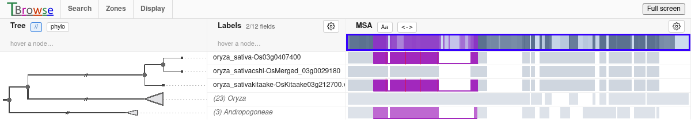

_Last updated: November 17, 2026_

**Ask the Rice PanGenome questions with an AI assistant**

You can ask questions about the Gramene Rice PanGenome in plain language and let an AI assistant look up the answers: genes and their function, orthologs and gene trees, presence and absence across the _Oryza_ genomes, expression, QTL, and rice lines that carry loss-of-function alleles. This server holds Rice PanGenome release 9, with 28 _Oryza_ genomes (cultivated rice and wild relatives) plus _Leersia_, maize, sorghum, Arabidopsis and other reference species.

The connection uses the Model Context Protocol (MCP), an open standard that lets an AI assistant call tools on a remote server. The Rice PanGenome MCP server is free and read-only, and it needs no account or sign-in with us. This guide uses Claude because it supports MCP servers on its free plan; other assistants are covered [further down](#other-ai-tools).

- [1. Get an assistant](#1-get-an-assistant)
- [2. Add the Rice PanGenome connector](#2-add-the-rice-pangenome-connector)
- [3. Turn it on in a chat](#3-turn-it-on-in-a-chat)
- [4. Example questions](#4-example-questions)
- [5. Browse a gene tree](#5-browse-a-gene-tree)
- [Tips](#tips)
- [Other AI tools](#other-ai-tools)
- [What the assistant can do](#what-the-assistant-can-do)
- [Privacy](#privacy)

---

## 1. Get an assistant

1. Create an account at [claude.ai](https://claude.ai). The free plan is enough to try this.
2. Use Claude in your browser, or install the desktop app for macOS or Windows.

Free plans limit how many custom connectors you can add and how many messages you can send in a few hours. A question that needs many lookups uses that allowance faster than an ordinary chat.

## 2. Add the Rice PanGenome connector

The server address is:

```
https://data.gramene.org/mcp/oryza_v9
```

1. In Claude, open **Settings** and choose **Connectors**.
2. Choose **Add custom connector**.
3. Enter a name, for example `Gramene Rice`, and paste the address above.
4. Leave the sign-in (OAuth) fields empty and choose **Add**.

On a Team or Enterprise plan, an organization owner may need to add the connector once before members can switch it on.

## 3. Turn it on in a chat

Start a new chat, open the tools menu below the message box, and switch **Gramene Rice** on. The first time Claude uses one of the tools it asks for permission; you can allow it once or for the whole chat.

Gramene runs a separate server for each of its sites, and they all offer the same tools. Keep only the one you need switched on in a chat, so the assistant does not mix data from two releases.

## 4. Example questions

Copy a question, paste it into the chat, and change the gene, region or trait to your own. The line under each question says what the answer draws on.

### Genes and IDs

```
What is the rice gene GS3 (Os03g0407400)? Give its location in Nipponbare and what is known about its function.
```
Gene record: location, description, protein domains, GO, Plant and Trait Ontology terms.

```
Find the Nipponbare genes whose description mentions heading date and list them with their positions.
```
Search by name and description within one genome.

```
How many Nipponbare genes are annotated with the GO term for starch biosynthesis?
```
A count by ontology annotation; ask for the list if you want it.

### Regions

```
List the Nipponbare genes on chromosome 3 between 16.7 and 16.8 Mb, with a short description of each.
```
Genes in an interval of the reference genome.

```
What are the ten genes on either side of Os03g0407400?
```
Genomic neighbourhood of one gene.

### Orthologs and gene families

```
What are the maize, sorghum and Arabidopsis orthologs of the rice gene SD1 (Os01g0883800)?
```
Orthologs from the Compara gene trees, by species.

```
Does Os01g0883800 have paralogs in Nipponbare?
```
Within-genome duplicates of one gene.

### Across the Oryza genomes

```
Which Oryza genomes have an ortholog of GS3 (Os03g0407400), and which wild species have none?
```
Presence/absence across the panel; GS3 is missing from some wild relatives.

```
How many protein-coding genes in Nipponbare have no ortholog in Oryza glaberrima?
```
A count across two genomes; ask for a sample of the genes if you want examples.

```
How many orthologs of GW5 (Os05g0187500) does each Oryza genome have? List the genomes with none or more than one.
```
Copy counts per genome for one gene.

### Expression

```
In which tissues is GS3 (Os03g0407400) most highly expressed? Name the experiments.
```
Baseline expression from curated RNA-seq experiments, by tissue.

```
In which experiments is SD1 (Os01g0883800) differentially expressed, and under what treatments?
```
Differential expression (log2 fold change) with the conditions compared.

### QTL and traits

```
How many rice QTL are annotated with the trait grain length? Show five examples with their positions.
```
Trait Ontology term to QTL from the Gramene QTL database.

```
How many Nipponbare genes lie inside QTL for days to heading, and how many of those are transcription factors?
```
Genes in QTL intervals for one trait, narrowed by annotation.

### Germplasm

```
Which rice accessions carry predicted loss-of-function alleles of GS3 (Os03g0407400)? Group them by the type of variant.
```
Lines with stop-gain, frameshift or splice variants, by consequence and zygosity.

### Pathways and literature

```
Which Nipponbare genes are in the starch biosynthesis pathway?
```
Plant Reactome pathway membership.

```
What has been published on GS3 (Os03g0407400)? Give PubMed IDs.
```
Curated literature references for a gene.

### Sequences

```
Give me the protein sequence of Os03g0407400 in FASTA format.
```
Sequence of the canonical transcript; genomic, cDNA and CDS are also available.

**Not on this site:** variant (rsID) lookups, which are available on the [SorghumBase](https://www.sorghumbase.org) server only.

## 5. Browse a gene tree

Ask to *see* a gene tree and the assistant opens an interactive viewer in the conversation instead of describing the tree in text:

```
Show me the gene tree for the rice gene GS3 (Os03g0407400).
```



The viewer shows the phylogeny with speciation and duplication nodes, gene labels and the protein alignment with its domains. You can collapse or prune clades, search for a gene, add the gene-neighbourhood and gene-structure panels from the **Zones** menu, and switch to full screen. Clicking a gene offers **Ask about this gene**, which sends that gene back to the chat as your next question.

The viewer appears in assistants that support MCP Apps, which include Claude on the web and the desktop app. Elsewhere you get a short text summary of the tree.

## Tips

- **Give stable IDs when you have them.** `Os03g0407400` is unambiguous; a gene symbol may match several genes, or genes in other species.
- **Name the genome.** Gene IDs and coordinates differ between assemblies. Say "in Nipponbare" for the reference, or name the genome (IR8, N22, _O. glaberrima_, _O. rufipogon_) when you mean another.
- **Be specific.** Name the organ ("inflorescence", "root") and say how to rank or filter. "Rank by root expression and ortholog function" gives a more repeatable answer than "find the best candidates".
- **Ask for counts before lists.** "How many genes…" is quick; a list of several thousand genes is long and will be cut short.
- **Ask for links.** The assistant can give the Rice PanGenome site links for the genes it reports, so you can check them in the browser.
- **Say what you want back.** A table, a ranked shortlist, FASTA, or a file to download.
- **Check before you act.** AI answers can be wrong. Confirm gene IDs, positions and germplasm names on [the Rice PanGenome site](https://oryza.gramene.org) before ordering seed or designing an experiment.

## Other AI tools

Any assistant or client that supports remote MCP servers over streamable HTTP can use the same address. In Claude Code:

```
claude mcp add --transport http gramene-rice https://data.gramene.org/mcp/oryza_v9
```

Setup instructions for VS Code, Cursor and other clients are in the [gramene-mcp README](https://github.com/warelab/gramene-mcp#connecting-to-mcp-clients).

## What the assistant can do

You do not need to name these tools; the assistant picks them. The table is here so you know what is possible.

| Tool | What it does |
|---|---|
| `solr_suggest` | Turns a word or phrase (a gene name, trait, pathway, protein domain, species) into the matching search terms |
| `gene_search`, `solr_search`, `solr_search_bool` | Find genes by any combination of filters, and count or summarize them |
| `resolve_gene_ids` | Maps older or alternative gene IDs to current ones |
| `genes_in_region` | Lists the genes in a chromosome interval |
| `expand_gene_set` | Orthologs, paralogs, whole gene families and neighbouring genes |
| `gene_tree_view` | Opens the interactive gene tree viewer |
| `expression_for_genes` | Expression by tissue and condition from curated RNA-seq experiments |
| `vep_for_gene` | Germplasm carrying predicted loss-of-function alleles of a gene |
| `pubmed_for_genes` | Publications linked to genes |
| `gene_sequence` | Genomic, cDNA, CDS or protein sequence |
| `mongo_find`, `mongo_lookup_by_ids` | Full records for genes, gene trees, genomes, ontology terms, pathways and QTL |

## Privacy

Your questions go to the AI provider you chose, under that provider's terms. Our server receives only the tool requests the assistant makes on your behalf, such as "genes in this region", and keeps a log of those requests, as any web server does. It never sees the rest of your conversation.

Questions or problems? Use the feedback link on [the Rice PanGenome site](https://oryza.gramene.org).
