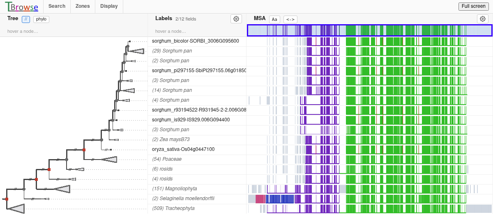

_Last updated: November 17, 2026_

**Ask SorghumBase questions with an AI assistant**

You can ask questions about the SorghumBase pan-genome in plain language and let an AI assistant look up the answers: genes and their function, orthologs and gene trees, presence and absence across the sorghum genomes, expression, QTL, and the EMS and natural-diversity lines that carry loss-of-function alleles. This server holds SorghumBase release 11, with 120 sorghum genomes plus maize, rice, Arabidopsis and other reference species.

The connection uses the Model Context Protocol (MCP), an open standard that lets an AI assistant call tools on a remote server. The SorghumBase MCP server is free and read-only, and it needs no account or sign-in with us. This guide uses Claude because it supports MCP servers on its free plan; other assistants are covered [further down](#other-ai-tools).

- [1. Get an assistant](#1-get-an-assistant)
- [2. Add the SorghumBase connector](#2-add-the-sorghumbase-connector)
- [3. Turn it on in a chat](#3-turn-it-on-in-a-chat)
- [4. Example questions](#4-example-questions)
- [5. Browse a gene tree](#5-browse-a-gene-tree)
- [Tips](#tips)
- [Other AI tools](#other-ai-tools)
- [What the assistant can do](#what-the-assistant-can-do)
- [Privacy](#privacy)

---

## 1. Get an assistant

1. Create an account at [claude.ai](https://claude.ai). The free plan is enough to try this.
2. Use Claude in your browser, or install the desktop app for macOS or Windows.

Free plans limit how many custom connectors you can add and how many messages you can send in a few hours. A question that needs many lookups uses that allowance faster than an ordinary chat.

## 2. Add the SorghumBase connector

The server address is:

```
https://data.gramene.org/mcp/sorghum_v11
```

1. In Claude, open **Settings** and choose **Connectors**.
2. Choose **Add custom connector**.
3. Enter a name, for example `SorghumBase`, and paste the address above.
4. Leave the sign-in (OAuth) fields empty and choose **Add**.

On a Team or Enterprise plan, an organization owner may need to add the connector once before members can switch it on.

## 3. Turn it on in a chat

Start a new chat, open the tools menu below the message box, and switch **SorghumBase** on. The first time Claude uses one of the tools it asks for permission; you can allow it once or for the whole chat.

Gramene runs a separate server for each of its sites, and they all offer the same tools. Keep only the one you need switched on in a chat, so the assistant does not mix data from two releases.

## 4. Example questions

Copy a question, paste it into the chat, and change the gene, region or trait to your own. The line under each question says what the answer draws on.

### Genes and IDs

```
What is the sorghum gene msd2? Give me its stable ID, where it is in BTx623 v3, and what is known about its function.
```
Gene record: location, description, protein domains, GO terms and pathways.

```
I have the older gene ID Sb06g018040. What is its current ID?
```
Maps a legacy identifier to the current stable ID.

```
How many genes in BTx623 v3 have a lipoxygenase domain? List them with their positions.
```
Search by protein domain, limited to one genome.

### Regions

```
List the BTx623 v3 genes on chromosome 6 between 46.5 and 46.65 Mb, with a short description of each.
```
Genes in an interval of the reference genome.

```
What are the ten genes on either side of SORBI_3006G095600?
```
Genomic neighbourhood of one gene.

### Orthologs, paralogs and gene families

```
What are the maize, rice and Arabidopsis orthologs of SORBI_3006G095600?
```
Orthologs from the Compara gene trees, by species.

```
Does SORBI_3006G095600 have paralogs in BTx623 v3? Show them with their chromosome positions.
```
Within-genome duplicates of one gene.

```
How many lipoxygenase genes do sorghum BTx623 v3, maize B73 and rice Nipponbare each have, per gene tree?
```
Family size compared between species.

### Across the sorghum pan-genome

```
Among the sorghum genomes included in the gene trees, which have no ortholog of SORBI_3006G095600, and which have more than one?
```
Presence/absence and copy number across the assembly panel. No ortholog can mean the gene is absent or was not annotated.

```
How many protein-coding genes in BTx623 v3 have no ortholog in Tx430?
```
A count across two genomes; ask for a sample of the genes if you want examples.

### Expression

```
In which tissues is SORBI_3006G095600 most highly expressed, and in which experiments?
```
Baseline expression by tissue from curated RNA-seq experiments, with the experiment where each tissue peaks.

```
Which BTx623 v3 lipoxygenase genes are expressed in the inflorescence but not in the leaf?
```
Combines a gene set with per-organ expression calls.

### Variants and germplasm

```
Which sorghum lines carry predicted loss-of-function alleles of msd2 (SORBI_3006G095600)? Group them by variant type, and separate EMS mutants from natural diversity lines.
```
Counts by variant type, zygosity and study. EMS mutants are named; large natural-diversity groups show examples, and you can ask for the full list.

```
Which genes does the variant rs162452973 fall in, and is it protein-altering in any genome?
```
One variant projected across the pan-genome.

### QTL and traits

```
How many QTL from the Sorghum QTL Atlas are annotated with the trait grain yield (TO:0000396)? Show five with their BTx623 v3 positions.
```
QTL records by Trait Ontology term and source.

```
List the BTx623 v3 genes in the QTL QPGYR5.1 (chromosome 5: 1,953,164 to 1,987,677). For each give its root expression level, its MAKER AED and its rice ortholog with description, then rank them as candidates for grain yield under low phosphorus.
```
Genes in the interval, weighed by the criteria you name; a shortlist to check, not a result.

### Pathways and literature

```
Which sorghum genes are in the jasmonic acid biosynthesis pathway?
```
Plant Reactome pathway membership.

```
Which PubMed IDs are linked to msd2 (SORBI_3006G095600) and to its rice and Arabidopsis orthologs?
```
Curated PubMed IDs. To have the papers summarised, the assistant also needs a literature tool.

### Sequences and gene models

```
Give me the protein sequence of SORBI_3006G095600 in FASTA format.
```
Protein sequence of each transcript; genomic, cDNA and CDS are also available.

```
How well supported is the gene model SORBI_3006G095600? Report its MAKER annotation edit distance.
```
Annotation quality scores for the gene model.

## 5. Browse a gene tree

Ask to *see* a gene tree and the assistant opens an interactive viewer in the conversation instead of describing the tree in text:

```
Show me the gene tree for SORBI_3006G095600.
```



The viewer shows the phylogeny with speciation and duplication nodes, gene labels and the protein alignment with its domains. You can collapse or prune clades, search for a gene, add the gene-neighbourhood and gene-structure panels from the **Zones** menu, and switch to full screen. Clicking a gene offers **Ask about this gene**, which sends that gene back to the chat as your next question.

The viewer appears in assistants that support MCP Apps, which include Claude on the web and the desktop app. Elsewhere you get a short text summary of the tree.

## Tips

- **Give stable IDs when you have them.** `SORBI_3006G095600` is unambiguous; a gene symbol may match several genes, or genes in other species.
- **Name the genome.** Gene IDs and coordinates differ between assemblies. Say "BTx623 v3" for the reference whose genes have `SORBI_3…` IDs; BTx623 v5 is a separate genome. Name the line (Tx430, Rio, a specific PI) when you mean another. About 80 of the genomes are in the gene trees; the rest have no ortholog calls.
- **Be specific.** Name the organ ("inflorescence", "root") and say how to rank or filter. "Rank by root expression and ortholog function" gives a more repeatable answer than "find the best candidates".
- **Ask for counts before lists.** "How many genes…" is quick; a list of several thousand genes is long and will be cut short.
- **Expression and germplasm answers start as summaries.** A gene can have hundreds of expression samples or carrier lines, so the assistant first gets the highlights: tissues, strongest contrasts, counts and examples. Ask for "every sample in root" or "the full list of lines" when you need more.
- **Expect IDs, not summaries, for papers.** The assistant returns PubMed IDs; it can only summarise the papers if it also has a literature tool.
- **Ask for links.** The assistant can give SorghumBase links for the genes it reports, so you can check them in the browser.
- **Say what you want back.** A table, a ranked shortlist, FASTA, or a file to download.
- **Check before you act.** AI answers can be wrong. Confirm gene IDs, positions and germplasm names on [SorghumBase](https://www.sorghumbase.org) before ordering seed or designing an experiment.

## Other AI tools

Any assistant or client that supports remote MCP servers over streamable HTTP can use the same address. In Claude Code:

```
claude mcp add --transport http sorghumbase https://data.gramene.org/mcp/sorghum_v11
```

Setup instructions for VS Code, Cursor and other clients are in the [gramene-mcp README](https://github.com/warelab/gramene-mcp#connecting-to-mcp-clients).

## What the assistant can do

You do not need to name these tools; the assistant picks them. The table is here so you know what is possible.

| Tool | What it does |
|---|---|
| `solr_suggest` | Turns a word or phrase (a gene name, trait, pathway, protein domain, species) into the matching search terms |
| `gene_search`, `solr_search`, `solr_search_bool` | Find genes by any combination of filters, and count or summarize them |
| `resolve_gene_ids` | Maps older or alternative gene IDs to current ones |
| `genes_in_region` | Lists the genes in a chromosome interval |
| `expand_gene_set` | Orthologs, paralogs, whole gene families and neighbouring genes |
| `gene_tree_view` | Opens the interactive gene tree viewer |
| `expression_for_genes` | Expression by tissue and condition from curated RNA-seq experiments |
| `vep_for_gene` | Germplasm carrying predicted loss-of-function alleles of a gene |
| `variant_genes` | The genes a variant (rsID) falls in, across the pan-genome |
| `saved_searches` | Searches that were saved and shared from the website |
| `pubmed_for_genes` | Publications linked to genes |
| `gene_sequence` | Genomic, cDNA, CDS or protein sequence |
| `mongo_find`, `mongo_lookup_by_ids` | Full records for genes, gene trees, genomes, ontology terms, pathways and QTL |

## Privacy

Your questions go to the AI provider you chose, under that provider's terms. Our server receives only the tool requests the assistant makes on your behalf, such as "genes in this region", and keeps a log of those requests, as any web server does. It never sees the rest of your conversation.

Questions or problems? Use the feedback link on [SorghumBase](https://www.sorghumbase.org).
